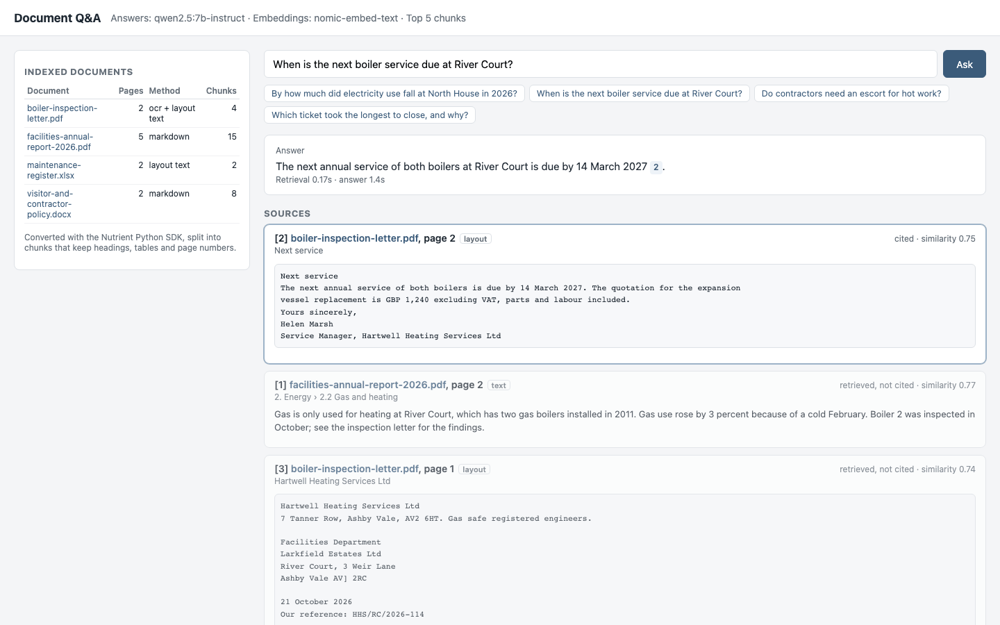
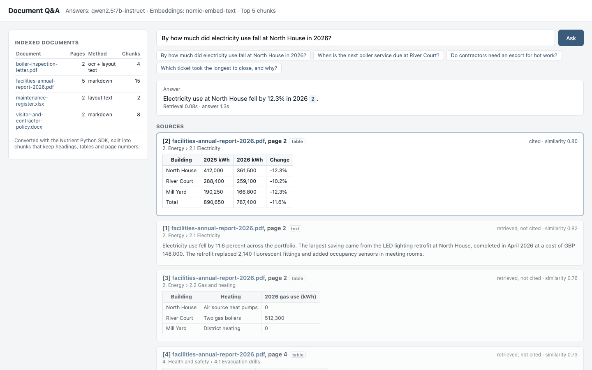

# Nutrient RAG Ingestion

A Nutrient.io demo that turns a folder of mixed documents into clean, page-numbered chunks with the Nutrient Python SDK, then answers questions about them with a local LLM that cites the document and page of every fact.



1. **Convert.** The Nutrient Python SDK converts every document to Markdown with a marker at the start of each page (`<!-- nutrient-page-start: N -->`):
   - PDF with a text layer and Word: Markdown export, with headings as `#` lines and tables as pipe tables;
   - scanned PDF: OCR with `PdfEditor.make_searchable()` in memory, then the layout text export, which keeps each table row on one line with its columns aligned;
   - Excel: layout text export, one sheet per page.
2. **Chunk.** `rag/chunking.py` splits the Markdown into chunks of about 1,200 characters at most (2,400 for layout text). A chunk never crosses a heading, a table stays whole with its caption, and layout text is split only at blank lines and at short title lines such as "Next service", so table rows stay together. Every chunk keeps its document, its page range and its section path (for example `3. Maintenance > 3.2 Lifts`). Page numbers and running headers or footers repeated on most pages are dropped.
3. **Embed.** Each chunk, prefixed with its document name and section path, is embedded with `nomic-embed-text` through the OpenAI-compatible endpoint of a local Ollama.
4. **Answer.** The question is embedded, the closest chunks are retrieved by cosine similarity, and `qwen2.5:7b-instruct` answers from them only, citing each fact as `[n]`. A small web page shows the answer, the cited passages with their document, page and section, and a link to the source file at that page.

Ingestion writes `output/markdown/<document>.md`, `output/chunks.json` (and `chunks.jsonl` for any other vector store), `output/vectors.npy` and `output/documents.json`.

## Prerequisites

- Python 3.10 or later (tested with 3.13)
- macOS on Apple Silicon, Linux x64 or Windows x64 (the Nutrient Python SDK native runtimes). Tested on macOS on Apple Silicon.
- [Ollama](https://ollama.com/download) with `qwen2.5:7b-instruct` (16 GB RAM recommended) and `nomic-embed-text` (274 MB), or any OpenAI-compatible endpoint
- Disk space for the OCR models that the SDK downloads to `~/.local/share/Nutrient` the first time it reads a scanned PDF

## Environment variables

Keys are only read from environment variables, never from code. Start from `.env.example`.

| Variable | Purpose | Default |
|---|---|---|
| `NUTRIENT_LICENSE_KEY` | Nutrient Python SDK license key | empty = evaluation mode |
| `LLM_BASE_URL` | OpenAI-compatible endpoint that writes the answers | `http://localhost:11434/v1` |
| `LLM_MODEL` | Answer model | `qwen2.5:7b-instruct` |
| `LLM_API_KEY` | API key of that endpoint | empty (Ollama needs none) |
| `EMBEDDING_MODEL` | Embedding model | `nomic-embed-text` |
| `EMBEDDING_BASE_URL`, `EMBEDDING_API_KEY` | Embedding endpoint and key | the `LLM_` values |
| `TOP_K` | Chunks retrieved per question | `5` |
| `DOCUMENTS_FOLDER` | Documents to ingest | `samples/documents` |
| `OUTPUT_FOLDER` | Markdown, chunks, vectors and evaluation | `output` |
| `HOST`, `PORT` | Address of the question page | `127.0.0.1`, `8000` |

## Build and run

```bash
python3 -m venv .venv
```

```bash
.venv/bin/pip install -r requirements.txt
```

```bash
ollama pull qwen2.5:7b-instruct
```

```bash
ollama pull nomic-embed-text
```

```bash
.venv/bin/python ingest.py
```

```bash
.venv/bin/python server.py
```

Open <http://localhost:8000>. To use the values from `.env`, load them first with `set -a && source .env && set +a`. On Windows, use `.venv\Scripts\python`.

`ingest.py --input <folder> --output <folder>` ingests another folder; `--no-embed` stops after the chunks. The question page does not use the Nutrient SDK, so it is not affected by the one-hour limit of an evaluation session.

## Using the app

1. The left panel lists the indexed documents with their pages, the conversion method and the number of chunks.
2. Type a question or click one of the examples. The answer cites its sources as numbered chips.
3. Below the answer, each retrieved passage shows its document, page, section path and type (`text`, `table` or `layout`). Cited passages are outlined; click a chip to jump to its passage, or the document name to open the source at that page (PDF).

   

## API

| Method and path | Description |
|---|---|
| `GET /api/config` | `{ model, embedding_model, top_k }` |
| `GET /api/documents` | The indexed documents: pages, method, chunks, tables, seconds |
| `POST /api/ask` | `{ question }`. Returns `{ answer, cited, sources, seconds }`; each source is a chunk with `n`, `score` and `cited` |
| `GET /files/{name}` | The original file of an indexed document |

## Evaluation

```bash
.venv/bin/python evaluate.py
```

`samples/questions.json` holds 13 questions with the document and page that answer them and the values the answer must contain, plus one question the documents cannot answer. The script checks whether the expected page is among the retrieved chunks, whether the answer contains the expected values and whether it cites the right document, and writes `output/evaluation.json`.

Result with `qwen2.5:7b-instruct` and `nomic-embed-text` on Ollama, top 5 chunks, Nutrient Python SDK 1.0.13 in evaluation mode, on an Apple Silicon laptop:

| Measure | Result |
|---|---|
| Expected page among the 5 retrieved chunks | 13/13 answerable questions (rank 1 for 10 of them) |
| Answer contains the expected values | 14/14 (including "the documents do not say" for the salary question) |
| Answer cites the right document | 13/14 (the salary answer cites a source although it says the documents do not say) |
| Time per question | 2.2 seconds on average (retrieval under 0.3 seconds) |
| Ingestion of the four documents | about 2 seconds for conversion and chunking, 3.4 seconds for the 29 embeddings |

The answer check accepts the wordings listed in `questions.json` (for example "4 min 40" or "4 minutes and 40"). In an earlier run, before OCR text was split at title lines such as "Next service", the next-service question failed: the passage was buried in a chunk with the measurements table and was not retrieved.

## Evaluation mode

The demo runs without a license key. Before building it, each conversion was tested in evaluation mode (Nutrient Python SDK 1.0.13):

| Conversion | Result in evaluation mode |
|---|---|
| PDF with a text layer, `export_as_markdown` | Complete text, headings, tables, page markers |
| Word, `export_as_markdown` | Complete text, headings, lists, tables |
| Scanned PDF, `make_searchable` then `export_as_text`, in memory | Complete text, table rows kept; a few OCR errors (for example `AV] 2RC` for `AV1 2RC`) |
| Scanned PDF, `make_searchable` then `export_as_markdown`, in memory | Complete text, but the table of readings breaks apart: labels and values end up on different lines. Not used |
| Scanned PDF, `make_searchable`, saved, then `export_as_markdown` | The saved copy carries a large "Nutrient SDK Trial Version" notice, which ends up in the first heading and breaks a table row. Not used |
| Excel, `export_as_markdown` | Table cells lose words and columns. Not used |
| Excel, `export_as_text` | Every row complete; the words of the evaluation notice ("Nutrient", "SDK Trial Version") appear in the header row |
| `Vision.extract_content()` (layout JSON with bounding boxes) | About half of the paragraphs are replaced by "This content is hidden in trial mode". Not used |

The notice words in the spreadsheet header row come from the evaluation notice and are left as they are. Each evaluation session of the SDK is limited to one hour, which is plenty for `ingest.py`; the question page does not use the SDK.

## Samples

`samples/documents` holds four fictitious documents of a property management company, generated by `samples/generate_documents.py`:

| File | Content |
|---|---|
| `facilities-annual-report-2026.pdf` | 5 pages, numbered headings, seven tables, page footers |
| `boiler-inspection-letter.pdf` | 2-page scanned letter (image only) with findings and a table of readings |
| `visitor-and-contractor-policy.docx` | Word policy with headings, a bullet list and two tables |
| `maintenance-register.xlsx` | Excel register: a sheet of tickets and a sheet of contractors |

To regenerate them:

```bash
.venv/bin/pip install -r samples/requirements.txt
```

```bash
.venv/bin/python samples/generate_documents.py
```

## Limitations

- **Formats.** Tested with digital PDF, scanned PDF, Word (`.docx`) and Excel (`.xlsx`), which are the formats `ingest.py` accepts. The SDK converts more formats (PowerPoint, images, email), but they were not tested here.
- **Scans.** OCR text has no Markdown headings or pipe tables. The chunker splits it at blank lines and at short title-like lines, and keeps table rows on one line with their columns aligned, which the model reads well. OCR errors stay in the text (`AV] 2RC` for `AV1 2RC` in the sample).
- **Spreadsheets.** One chunk per sheet page, up to 2,400 characters. The sheet name is not in the output, and the header row carries the evaluation notice words in evaluation mode.
- **Retrieval.** Plain cosine similarity over a NumPy array, which is fine for thousands of chunks. For larger collections, load `chunks.jsonl` and the embeddings into a vector database. There is no re-ranking and no hybrid keyword search.
- **Model.** Tested with `qwen2.5:7b-instruct` only. A stronger model would give fuller answers (the 7B model answers the hot work question with "yes, plus a permit" and leaves out the 60-minute fire watch) and follows the "cite nothing" rule more reliably; this was not tested here. `nomic-embed-text` works with the `search_document:` and `search_query:` prefixes set in `rag/llm.py`; another embedding model may need other prefixes.
- **Viewer.** The page links open the original file in the browser's own viewer; there is no highlight of the passage on the page.

## Project layout

| Path | Content |
|---|---|
| `ingest.py` | Convert, chunk and embed a folder of documents |
| `rag/convert.py` | Nutrient Python SDK conversion: Markdown, OCR, layout text |
| `rag/chunking.py` | Heading, table and page aware chunking |
| `rag/llm.py` | Embeddings, retrieval and cited answers through OpenAI-compatible endpoints |
| `server.py`, `web/` | Question answering page |
| `evaluate.py`, `samples/questions.json` | Retrieval and answer evaluation |
| `samples` | Fictitious documents and their generator |
